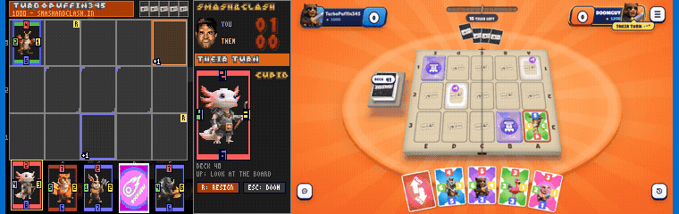
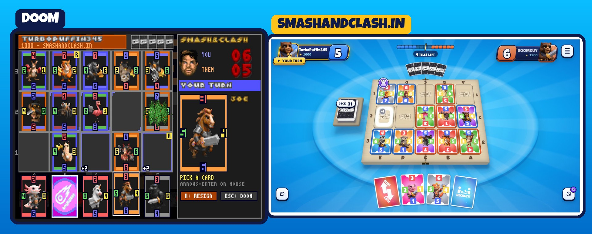
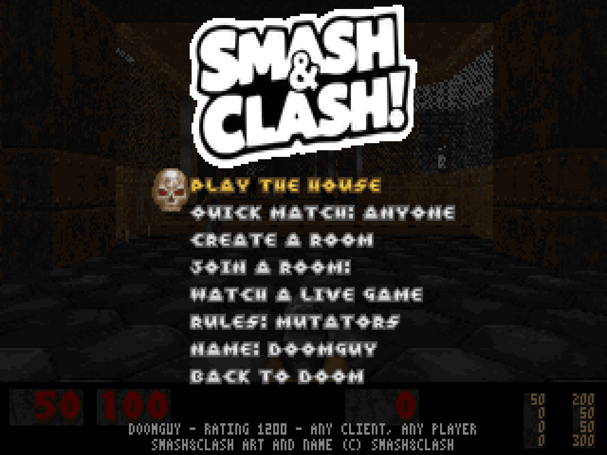
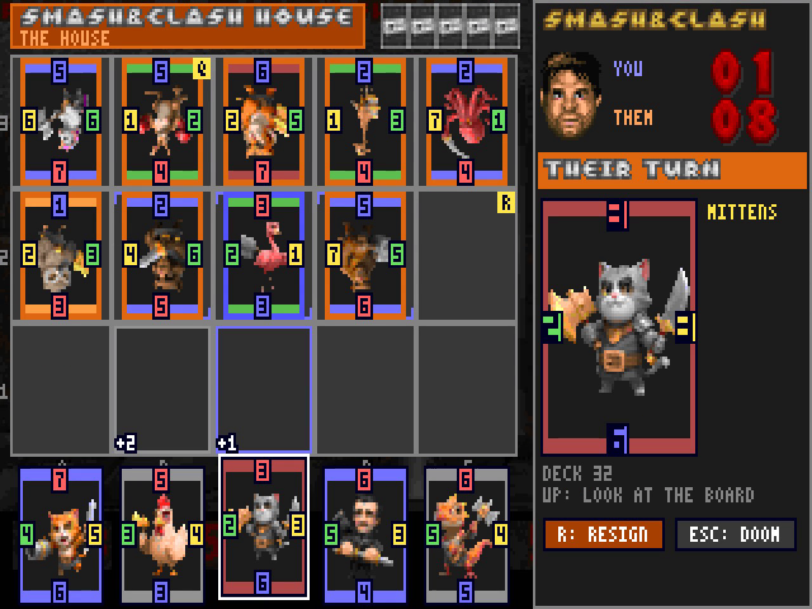
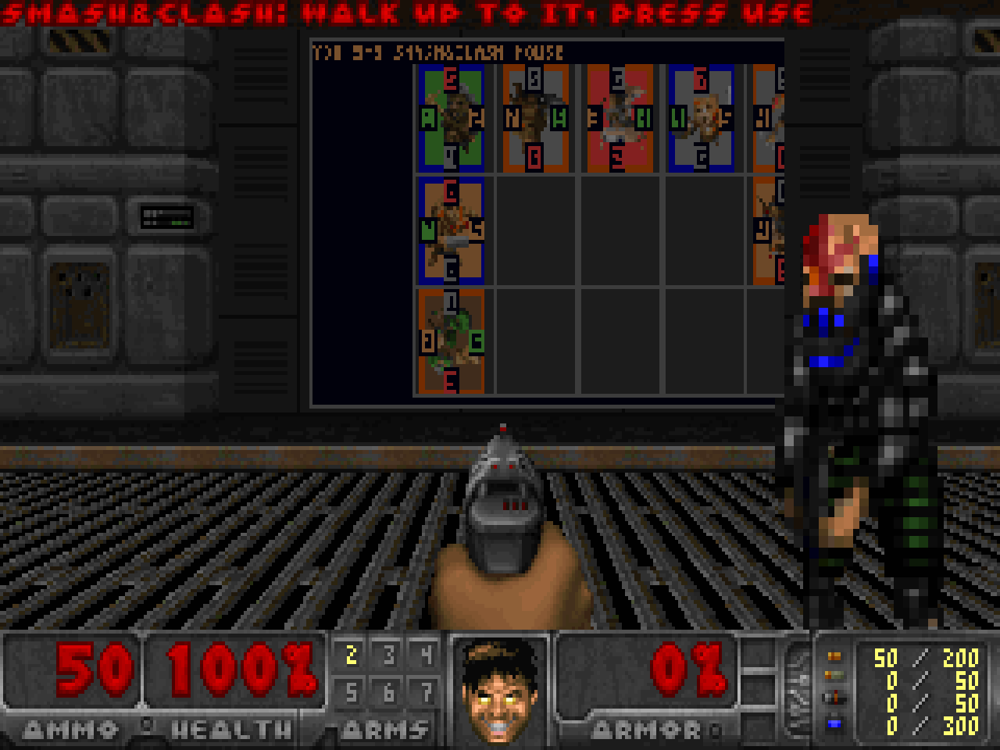
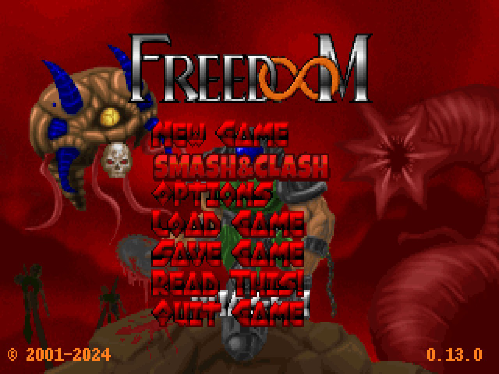

<p align="center">
  
</p>

<h1 align="center">Can DOOM run Smash&Clash?</h1>

<p align="center">
  <a href="https://doom.smashandclash.in">Play it in your browser</a> ·
  <a href="https://docs.smashandclash.in/clients">One game, every client</a> ·
  <a href="https://docs.smashandclash.in/sdk">SDK</a> ·
  <a href="https://www.smashandclash.in">smashandclash.in</a>
</p>

<p align="center">
  <b>Watch:</b>
  <a href="https://github.com/smashandclash/doom/releases/download/v1.0.0/smashandclash-doom-launch-16x9.mp4">the launch film (16:9)</a>
</p>



"Can it run DOOM?" Yes, sure: calculators, pregnancy tests and potatoes all run DOOM ([canitrundoom.org](https://canitrundoom.org) lists 195 of them). This goes the other way. **DOOM runs Smash&Clash.**

It's not an embed or a web page in a window. The DOOM engine is the client. The 1993 renderer draws the board, the cards and the menus into its own 320×200, 256-colour screen, with its own HUD font, status-bar face, sprites and sounds. Every computer screen in E1M1 shows a live game. And it plays on the same network as everyone else: the website, the apps, Telegram, Minecraft, GTA V, a Nintendo DS, the terminal and AI agents. Rooms, codes and quick match work across all of them.

It's built on the [Smash&Clash SDK](https://docs.smashandclash.in/sdk).

## Playing

- **Get to the game:** walk up to any computer screen in a level and press **Use** (`Space` / `E`). You can also press **C** anywhere, or pick **SMASH&CLASH** in DOOM's main menu. **T** teleports you to the next computer screen on the level.
- **Play the house** starts a game now, against an opponent at your level. **Quick match** joins the queue every Smash&Clash app shares (choose anyone, people or agents). **Create a room** makes a code anyone joins on any app, and **Join a room** takes theirs.
- **While you play,** pick a card with the arrows (or `1`–`5`) and `Enter`, then a glowing tile. The mouse works too. `Tab` steps through every legal move by name, `R` resigns and `Esc` goes back to DOOM. The game waits on the network, so walk off and come back: the computers show where it stands, and the HUD tells you when it's your turn.
- Mutators and Classic, your rating, and the Game Review's accuracy after each game. Captures go off as rocket explosions, hops use the teleport fog and a Boulder is a BFG blast. Doomguy grins when you take cards.
- **Watch a live game** puts the network's featured game on the terminal. When you're not playing, the computer screens show it too.

| | |
| --- | --- |
|  |  |
|  |  |

## How it works

DOOM has no network, so the page runs `@smashandclash/sdk` next to the engine. The Smash&Clash GBA client does the same, carrying each call over a bridge.

```
 DOOM (doomgeneric, C -> WebAssembly)                  the page (JS)
 ┌───────────────────────────────────┐  snc_push()   ┌────────────────────────────┐   HTTPS   Smash&Clash
 │ engine/snc.c  draws, animates,    │ <──────────── │ web/bridge.js              │ <───────> game network
 │ picks moves; wall screens; menu   │ ────────────> │ @smashandclash/sdk 0.6.0   │
 └───────────────────────────────────┘ snc_js_send() └────────────────────────────┘
```

- `bridge.js` reads the seat sync (`game.sync`), the legal moves as data (`game.view.moves`) and the deck (`cards()`), and hands the engine snapshots as tab-separated lines. The engine sends back commands: `play <move>`, `house`, `quick`, `room`, `join <code>`, `watch`, `resign`, `leave`.
- Moves are played by name from the network's legal moves, and the network decides every one. The engine only sees what a player at the table could: your hand, the board, and counts for the other hand.
- The card art, the card back and the logo are baked into a PWAD (`smashandclash.wad`) in DOOM's own palette, so the engine draws them like any other graphic.
- The engine is [doomgeneric](https://github.com/ozkl/doomgeneric) at a pinned commit. `tools/build-wasm.mjs` adds a few small hooks: the event chain, the display, the main menu, the USE line check, the wall-texture column fetch and the typed-character path (so cheats still work with WASD).

It follows the [client checklist](https://docs.smashandclash.in/clients). It hosts by code and opens codes and `?join=` / `?game=&invite=` links through `games.open()`. It uses the one quick-match queue and leaves it with `leave()`. It sends its name (`smashandclash-doom`), `as: 'person'` and the player's rating. You are blue and they are orange, their cards face them as at a real table, and every opponent has a name.

## Develop

You need Node 20+, Python 3 with Pillow (WebP support) and Emscripten (`EMSDK` set).

```bash
node tools/freedoom.mjs
```

```bash
node tools/fetch-deck.mjs
python tools/bake.py web/freedoom1.wad build/deck.json web/smashandclash.wad
```

```bash
node tools/build-wasm.mjs
node tools/serve.mjs
```

`freedoom.mjs` downloads Freedoom 0.13.0 into `web/` (checksum-checked). `fetch-deck.mjs` reads the deck and the client kit through the SDK, and `bake.py` turns them into the PWAD. `build-wasm.mjs` compiles doomgeneric with `engine/*.c` into `web/doom.js` and `web/doom.wasm`, and `serve.mjs` serves `web/` at http://localhost:8123/. `?timer=1` drives the engine from `setTimeout` instead of `requestAnimationFrame`, for a page in the background (automated tests).

| Part | Does |
| --- | --- |
| `engine/snc.c` | The client in DOOM: the terminal (lobby, board, hand, preview, result), picking a move, the animations with DOOM's sprites and sounds, the computer screens, USE and T |
| `engine/platform.c` | DOOM's platform: frames to the canvas, keys and the mouse, sound effects through Web Audio |
| `web/bridge.js` | The Smash&Clash side: runs the SDK, turns the seat sync into snapshots, plays the engine's commands |
| `web/main.js` | The page: loads the WADs and the engine, input, sound, music, shared links |
| `tools/` | Freedoom, the deck, the PWAD baker, the engine build and a dev server |

## Licence

The engine and this repo's C code are GPL-2.0, like doomgeneric and the DOOM source (see `LICENSE`). `web/sdk/` is `@smashandclash/sdk` (MIT). The game data is [Freedoom](https://freedoom.github.io/) (BSD-3-Clause); it's downloaded at build time, not committed.

The characters, art, audio and the Smash&Clash name stay Smash&Clash's. They're free to use in clients built for Smash&Clash, never to present as your own ([terms](https://www.smashandclash.in/terms#developers)).

DOOM is a trademark of id Software. This project uses the open-source engine and Freedoom's free game data, not id's. It isn't affiliated with or endorsed by id Software, Bethesda or ZeniMax. The project photos in the launch film are from [canitrundoom.org](https://canitrundoom.org).
